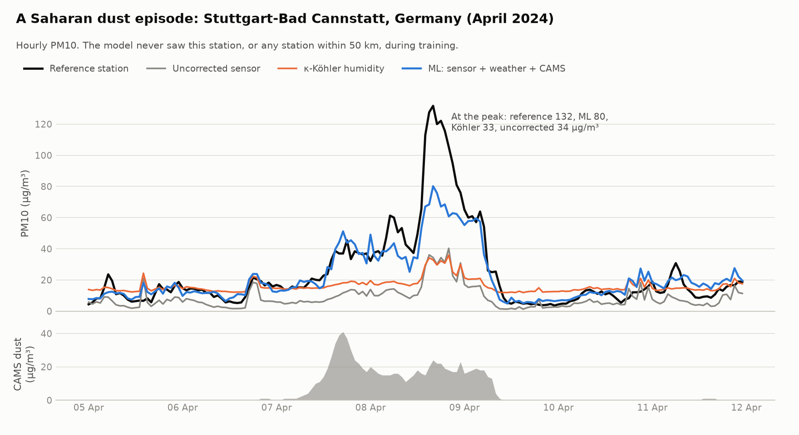
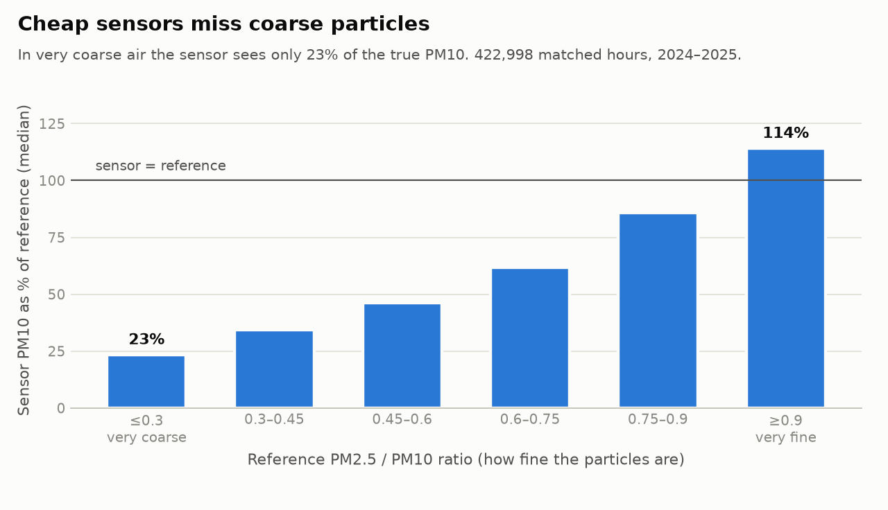
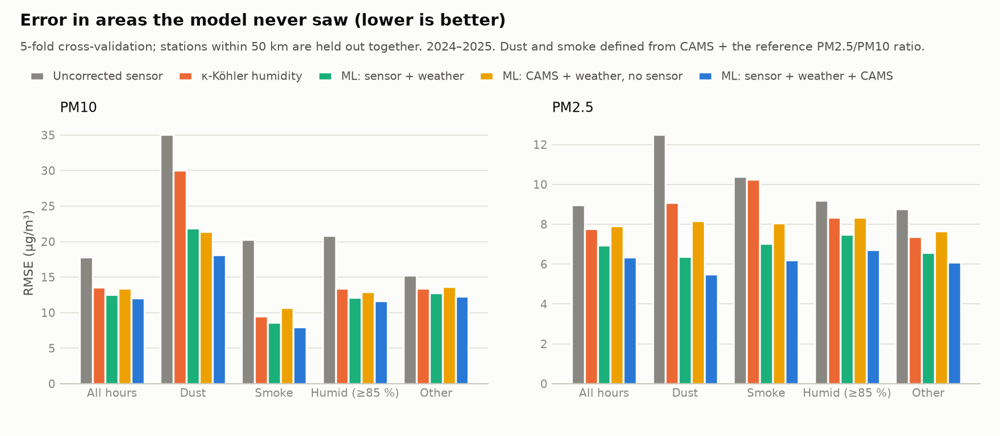
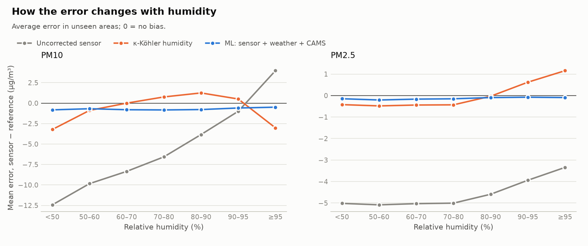
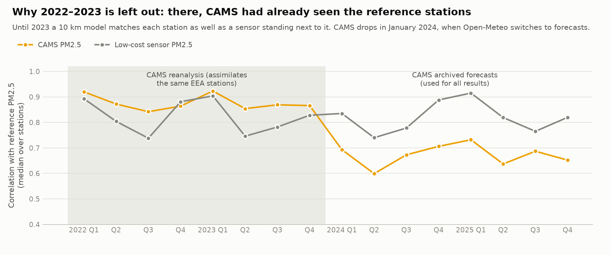

# Correcting low-cost PM sensors during Saharan dust, smoke and humid air

Low-cost optical particle sensors (like the SDS011 used by thousands of citizen-science
stations) are cheap enough to put everywhere, but their readings drift with humidity and
they largely miss coarse particles such as Saharan dust. This project measures how large
those errors are across Europe and tests which correction methods hold up in areas the
model has never seen, with a focus on dust episodes, wildfire smoke and humid air.

**Data:** 772,000 matched hours (2024–2025) from 65 Sensor.Community sensors next to 54 official
EEA stations in 13 countries, with hourly weather (ERA5) and dust/aerosol forecasts from the
Copernicus Atmosphere Monitoring Service (CAMS). Earlier years are left out on purpose: see
[Why only 2024–2025](#why-only-20242025).

## Key findings

1. **Cheap sensors miss coarse particles.** In very coarse air (reference PM2.5/PM10 ≤ 0.3,
   typical of dust) the sensor reports only **23 %** of the true PM10 (median); in fine air it
   reports 86–114 %.
2. **Humidity pushes the error both ways.** Uncorrected PM10 is 12 µg/m³ too low in dry air and
   4 µg/m³ too high above 95 % relative humidity. The standard κ-Köhler humidity correction
   removes most of this but is still about 3 µg/m³ off at both extremes; the machine-learning
   correction stays within 1 µg/m³ across the whole range.
3. **During dust episodes, humidity corrections are not enough.** Uncorrected sensors read PM10
   68 % too low in dust hours. The error (RMSE) in unseen areas falls from 35.1 µg/m³ uncorrected
   to 30.0 with κ-Köhler, but to **18.1 µg/m³** (−48 %) with a gradient-boosting model that also
   knows the CAMS dust forecast. Against κ-Köhler that is 40 % lower (95 % interval 34–50 % when
   whole areas are resampled).
4. **The sensor still matters.** The same model without the sensor (CAMS + weather only) is worse
   in every condition: PM2.5 RMSE 7.9 vs 6.3 µg/m³ overall, PM10 21.4 vs 18.1 in dust.
5. **Smoke is a different problem.** Smoke particles are fine, so the sensor does see them, but in
   smoke hours its PM2.5 follows the reference only loosely (r = 0.54). The full model brings the
   error down from 10.4 to 6.2 µg/m³; with only 673 smoke hours this is the least certain result.

<picture>
  <source media="(prefers-color-scheme: dark)" srcset="figures/dust_episode_dark.png">
  
</picture>

<picture>
  <source media="(prefers-color-scheme: dark)" srcset="figures/coarse_underestimation_dark.png">
  
</picture>

<picture>
  <source media="(prefers-color-scheme: dark)" srcset="figures/rmse_by_condition_dark.png">
  
</picture>

<picture>
  <source media="(prefers-color-scheme: dark)" srcset="figures/bias_vs_humidity_dark.png">
  
</picture>

### Results table

RMSE in µg/m³ in areas the model never saw (lower is better); stations within 50 km of each other
are always held out together. All methods, including the two linear calibrations, are in
[`results/metrics.csv`](results/metrics.csv), which also has R², MAE and bias.

| | Hours | Uncorrected | κ-Köhler | ML: sensor + weather | ML: CAMS + weather, no sensor | **ML: sensor + weather + CAMS** |
|---|---:|---:|---:|---:|---:|---:|
| **PM10**, all hours | 737,154 | 17.8 | 13.6 | 12.6 | 13.4 | **12.1** |
| PM10, dust | 4,145 | 35.1 | 30.0 | 21.9 | 21.4 | **18.1** |
| PM10, smoke | 673 | 20.3 | 9.5 | 8.6 | 10.7 | **8.0** |
| PM10, humid (≥ 85 %) | 289,320 | 20.8 | 13.4 | 12.2 | 12.9 | **11.7** |
| **PM2.5**, all hours | 666,107 | 9.0 | 7.8 | 6.9 | 7.9 | **6.3** |
| PM2.5, dust | 4,145 | 12.5 | 9.1 | 6.4 | 8.2 | **5.5** |
| PM2.5, smoke | 673 | 10.4 | 10.2 | 7.0 | 8.0 | **6.2** |
| PM2.5, humid (≥ 85 %) | 261,182 | 9.2 | 8.4 | 7.5 | 8.3 | **6.7** |

For PM2.5 the best κ on the training data was 0 in every fold, so the κ-Köhler column equals the
plain linear calibration there: with grid-scale humidity, the growth correction did not help PM2.5.
For PM10 κ was 0.1–0.2.

## Why only 2024–2025

For 2022–2023, Open-Meteo serves the CAMS European **reanalysis**, which assimilates (blends in)
measurements from EEA stations, including the reference stations used here as the truth. From
January 2024 the values are archived **forecasts**, the kind a real-time system would have. The
switch is plain in the data. Until December 2023 the median per-station correlation of CAMS PM2.5
with the reference is 0.84–0.92 in every quarter: a model on a 10 km grid matches each station as
well as a low-cost sensor standing next to it, which only makes sense if it has already seen that
station. From January 2024 it is 0.60–0.73, while the sensors stay level.

<picture>
  <source media="(prefers-color-scheme: dark)" srcset="figures/cams_check_dark.png">
  
</picture>

It also shows in the models. Trained and tested on 2022–2023, the CAMS-only model (no sensor at
all) reaches a dust-hour PM10 RMSE of 12.7 µg/m³, slightly better than the model that also has the
sensor (13.1), against 21.4 in 2024–2025: it was partly being shown the answer. A first version of
this project used all four years and so overstated what CAMS adds. All results here use 2024–2025
only.

## Robustness checks

[`src/robustness.py`](src/robustness.py) repeats the comparison in the ways a reviewer would ask
for. RMSE in µg/m³:

| Check | PM10 dust: κ-Köhler | PM10 dust: no sensor | PM10 dust: full model | PM2.5 all: no sensor | PM2.5 all: full model |
|---|---:|---:|---:|---:|---:|
| Main result (areas held out) | 30.0 | 21.4 | **18.1** | 7.9 | **6.3** |
| One group per station instead of per area | 29.9 | 20.5 | **16.9** | 7.6 | **6.0** |
| Train on 2024, test on 2025 (unseen areas) | 31.4 | 27.4 | **24.9** | 8.7 | **6.7** |
| 2022–2023, CAMS reanalysis (for comparison) | 22.6 | **12.7** | 13.1 | 8.3 | **6.2** |

- **Holding out areas matters a little.** With one group per station, a test station can have a
  training neighbour in the same city; the error is then slightly lower, so the area grouping is the
  stricter and more honest test.
- **A year ahead.** Trained on 2024 only and tested on 2025, the full model is still the best in every
  condition, but its lead in dust shrinks (24.9 vs 31.4 µg/m³ for κ-Köhler): with one year of
  training data there are few dust episodes to learn from.
- **Uncertainty.** Resampling whole areas (cluster bootstrap, 2,000 resamples), the full model's PM10
  dust RMSE is 40 % lower than κ-Köhler (95 % interval 34–50 %) and 15 % lower than the no-sensor
  model (7–22 %).
- **CAMS false alarms.** In 1,947 hours CAMS forecast at least 10 µg/m³ of dust but the reference air
  was not coarse (PM2.5/PM10 > 0.5). The full model's mean error in those hours is +1.5 µg/m³ (RMSE
  11.5 vs 15.4 for κ-Köhler), so it does not simply add dust whenever CAMS calls for it.
- **Where the dust hours come from.** 4,145 dust hours on 127 days at 39 stations in 10 countries; the
  largest single contributor is Skopje-Lisice (North Macedonia) with 23 % of them.

## Why it matters

Networks of cheap sensors are spreading fast, including in cities with few official stations.
Saharan dust episodes are frequent in southern and south-eastern Europe, and these are exactly the
days when uncorrected sensors under-report the most. Combining the sensor with freely available
CAMS forecasts recovers much of the missing PM10, which matters for public health warnings and for
judging when daily limit values are exceeded.

## Data

All data is open; nothing in this repository requires an account.

| Source | What | Used for |
|---|---|---|
| [Sensor.Community](https://sensor.community/) archive | Raw readings from citizen-science PM sensors (mostly SDS011) | The low-cost sensors to correct |
| [EEA Air Quality Download Service](https://eeadmz1-downloads-webapp.azurewebsites.net/) | Verified hourly PM10 and PM2.5 from official monitoring stations | Reference ("truth") |
| [Open-Meteo](https://open-meteo.com/) historical weather (ERA5) | Humidity, temperature, dew point, boundary layer height, wind, rain, clouds, pressure | Model inputs |
| [Open-Meteo](https://open-meteo.com/) air quality (Copernicus CAMS) | Surface dust, aerosol optical depth, carbon monoxide, modelled PM: archived forecasts from 2024, reanalysis before | Model inputs and episode labels |

The download scripts fetch 2022–2025; 2022–2023 is used only for the CAMS check above.

**Pairing.** A low-cost sensor is paired with a reference station if it is within 100 m of a
traffic station or within 500 m of a background or industrial station. Traffic stations get
the stricter limit because air quality changes block by block along busy roads.
Sensor.Community rounds published positions to roughly 100 m, so distances are approximate.

**Cleaning.**
- Sensor readings are averaged to hourly means; hours with fewer than 15 readings, saturated
  values (≥ 999 µg/m³) and days when the sensor was more than 200 m from its current position
  are dropped.
- Only reference values the EEA marks as valid are used.
- Timestamps are converted to UTC. A cross-correlation check showed that a few stations label
  their hours differently (the best match is 1–2 h off, the same in summer and winter, so not a
  daylight-saving issue); those stations get a fixed offset.
- Pairs where the sensor does not follow the reference at all (r < 0.3 at any time shift) are
  excluded as broken or not measuring the same air, and so are pairs with under 500 overlapping
  hours, which are too short to check.

**Episodes** (used only to evaluate, never as model inputs):
- **Dust:** CAMS surface dust ≥ 10 µg/m³ *and* reference PM2.5/PM10 ≤ 0.5 (the model and the
  measurement must agree, which filters out road dust and CAMS false alarms; the false alarms are
  checked separately above)
- **Smoke:** CAMS carbon monoxide ≥ 1.5 × its monthly median at the site *and* reference
  PM2.5/PM10 ≥ 0.75, May–September only (so winter wood burning is not counted)
- **Humid:** ERA5 relative humidity ≥ 85 %

## Method

Seven approaches are compared, from no correction to machine learning:

| Method | What it does |
|---|---|
| Uncorrected | The sensor's own value |
| Linear | `reference = a + b × sensor` |
| Linear + humidity | adds relative humidity and temperature |
| κ-Köhler humidity | divides the sensor value by the hygroscopic growth factor 1 + (κ/1.65)/(1/aw − 1), then a linear fit; κ is chosen on the training data |
| ML: sensor + weather | LightGBM gradient boosting with both sensor channels, their ratio, weather and time of day/year |
| ML: CAMS + weather, no sensor | the same model without the sensor: shows what CAMS achieves on its own |
| ML: sensor + weather + CAMS | sensor and weather plus CAMS dust, aerosol optical depth, carbon monoxide and modelled PM |

**Validation.** Five-fold cross-validation grouped by area: stations within 50 km of each other,
and the sensors attached to them, are always in the same fold, so every prediction is made for an
area the model never saw during training. No training station shares a city or a weather/CAMS grid
cell with the station being tested. This mimics the real use case: calibrating sensors in a new city
that has no co-located reference.

## Limitations

- **Geography.** Three quarters of the data come from Germany, Belgium and Poland, where dust
  episodes are rarer and weaker than in southern Europe. No Croatian sensor is close enough to a
  reference station to be included.
- **Grid-scale weather.** Humidity and dust come from ERA5 and CAMS (roughly 10–25 km grids), not
  from the sensor's own location. Many sensors have their own humidity sensor, which was not used.
- **CAMS forecasts are not fully independent of the station network.** Each forecast starts from an
  analysis that assimilated the previous day's station data. In a city with no reference station,
  CAMS may be somewhat less accurate than here.
- **Episode labels are proxies.** Dust and smoke hours are identified from CAMS plus the reference
  PM2.5/PM10 ratio; they are used only to evaluate, never as model inputs.
- **Sensor snapshot.** Pairs were found from sensors active in November 2026, so sensors retired
  earlier are missing. Nearly all sensors are the SDS011 model.
- **Two years.** Because the reanalysis years are left out, only 2024–2025 is used; the 2024 → 2025
  hold-out tests a single year ahead.

## Walkthrough notebook (Croatian)

[`notebooks/vodic_kroz_analizu.ipynb`](notebooks/vodic_kroz_analizu.ipynb) goes through the whole analysis step by step in Croatian: data, the CAMS reanalysis check, time alignment, sensor errors, the κ-Köhler correction, why validation is grouped by area (with a random-split comparison), results, robustness checks, feature importance and practice questions. It runs in a few minutes on the processed data: `uv run jupyter lab`.

## Reproduce

Requires [uv](https://docs.astral.sh/uv/). Downloads are about 1.5 GB and are kept in `data/`
(not committed).

```bash
uv sync
uv run python src/find_pairs.py            # downloads station + sensor lists, finds pairs
uv run python src/download_sensors.py      # Sensor.Community daily archive, ~30 min
uv run python src/download_eea.py          # EEA reference data
uv run python src/process_sensors.py
uv run python src/process_eea.py
uv run python src/check_time_alignment.py  # time offsets + broken-pair check
uv run python src/download_meteo.py        # Open-Meteo, paced to the free limits
uv run python src/build_dataset.py
uv run python src/train_evaluate.py        # results/metrics.csv
uv run python src/robustness.py            # results/robustness.csv, bootstrap.csv, cams_check.csv
uv run python src/make_figures.py          # figures/
```

## Credits and licences

- Low-cost sensor data: [Sensor.Community](https://sensor.community/) contributors,
  [Open Data Commons DbCL 1.0](https://opendatacommons.org/licenses/dbcl/1-0/)
- Reference data: European Environment Agency, Air Quality e-Reporting, CC BY 4.0
- Weather and atmospheric composition: [Open-Meteo](https://open-meteo.com/) (CC BY 4.0), based on
  ECMWF ERA5 and the Copernicus Atmosphere Monitoring Service (CAMS)
- Code: MIT licence

Author: [Petar Krešimir Borić](https://github.com/pboric)
